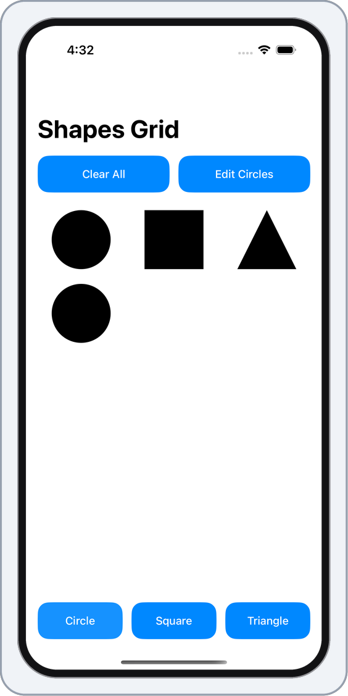
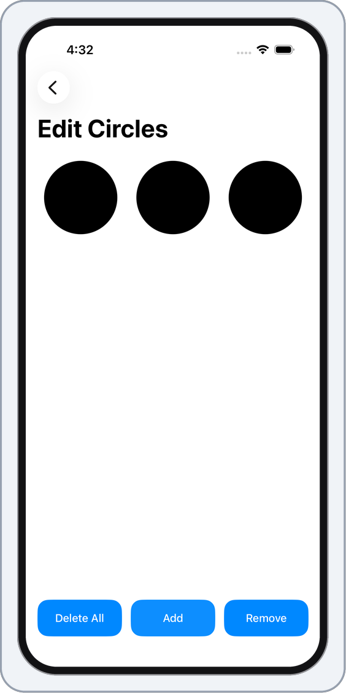
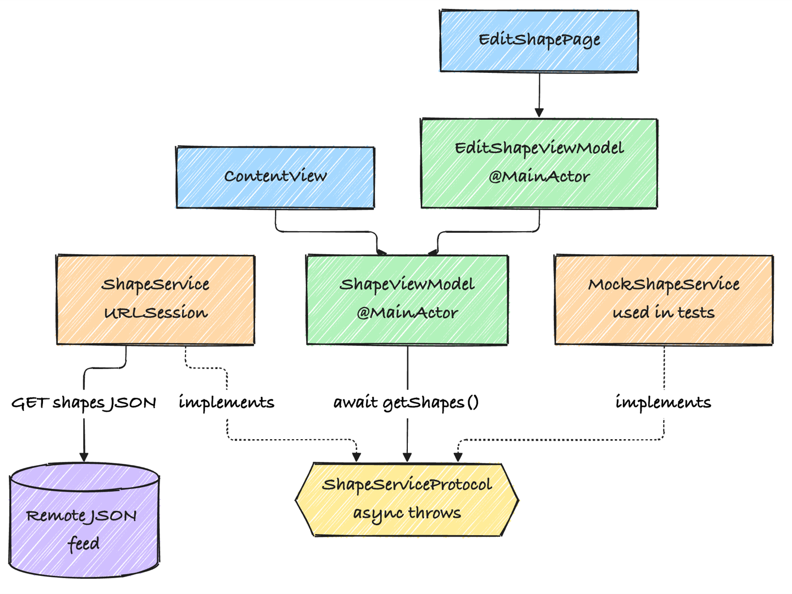

<div align="center">

# ShapeButtonsApp

A small SwiftUI app that builds its buttons from a JSON file on the web and lets you fill a grid with shapes.


<br>


&emsp;&emsp;&emsp;&emsp;&emsp;&emsp;


</div>

## What it does

When the app opens it downloads a short JSON file that lists the shapes it should offer. Each entry becomes a button along the bottom of the screen: Circle, Square and Triangle. Tap a button and that shape is added to the grid. Clear All empties the grid.

Edit Circles opens a second screen that shows only the circles. From there you can add a circle, remove the last one, or delete them all. It shares its data with the main screen, so the grid updates when you go back.

The buttons are loaded from the web when the app opens, so it needs a connection. If the download fails, the screen shows what went wrong and a Try Again button instead of the buttons. If there are more buttons than fit across the screen, the row scrolls.

A new entry in the file will show up as a button, but the app only knows how to draw a circle, a square and a triangle. Any other name is shown as an empty cell.

## How it's built

The app uses MVVM with Swift's Observation framework. The view models are `@Observable` classes, and the views own them with `@State`, which is what Apple recommends for iOS 17 and later. The views only draw things. Anything that changes data goes through a method on a view model, and the view model's state is `private(set)`, so a view can't change it directly. The small views take plain values and closures, for example the button row gets a list of buttons and an `onSelect` closure.

The view models don't talk to the network. They call a `ShapeServiceProtocol`, and the real `ShapeService` (or a test double) is handed to them when they're created.

<p align="center">
  
</p>

The network call is a single async function:

```swift
protocol ShapeServiceProtocol: Sendable {
    func getShapes() async throws(ShapeServiceError) -> ShapeModel
}
```

`ContentView` starts the fetch from a `.task`. Both view models are marked `@MainActor`, so nothing needs to hop back to the main thread by hand, and the whole project builds in Swift 6 language mode.

Two things about the feed are worth knowing. It's served over plain `http`, and it has trailing commas, which strict JSON doesn't allow. `ShapeService` turns on the decoder's JSON5 mode, which does. It also checks the HTTP status, so a server error shows up as a server error and not as a decoding problem.

## Running it

You need Xcode 16.3 or later. The deployment target is iOS 18.4, and the project uses Swift 6 language mode and typed throws. It was last built and tested with Xcode 27.2.

```bash
git clone https://github.com/makambo13/ShapeButtonsApp.git
cd ShapeButtonsApp
open Circuit.xcodeproj
```

Pick an iPhone simulator and press Run (⌘R).

## Tests

Press ⌘U in Xcode to run everything. From the command line, find a simulator ID first and pass it in:

```bash
xcrun simctl list devices available
xcodebuild test -project Circuit.xcodeproj -scheme Circuit \
  -destination 'id=<SIMULATOR_ID>'
```

(Picking a simulator by name didn't work on the Mac this was tested on, so the command above uses the ID.)

- The view model tests cover adding, clearing and removing shapes, loading the buttons, the failure message, and trying again after a failure.
- The service tests run `ShapeService` against a stubbed `URLProtocol`, so they never touch the network. They cover the feed with trailing commas, clean JSON, a server error, bad JSON, and a lost connection. I also ran them on an iOS 18.4 simulator, the oldest version the app supports.
- The UI tests launch the app with a built-in fake feed (the `-UITestStubFeed` launch argument, available in debug builds), so they don't depend on the website being up. They tap through both screens, check that the whole button responds and not just its label, and check the error screen and the scrolling row.
- The layout tests check that every button sits inside the screen and doesn't overlap its neighbour, in portrait, in landscape, and with large accessibility text. I've only run these on an iPhone 17 Pro simulator.

## Project layout

```
Circuit/
  CircuitApp.swift                App entry point
  ContentView.swift               Main screen and the shape grid
  ShapeViewModel.swift            State for the main screen, loads the feed
  EditShapePage.swift             Edit Circles screen
  EditShapeViewModel.swift        Add, remove and delete circles
  ButtonButtonView.swift          The bottom row of buttons built from the feed
  TopStaticButton.swift           Clear All and Edit Circles
  EditShapeBottomView.swift       Delete All, Add and Remove
  CustomButtonViewModifier.swift  The shared blue ButtonStyle
  Persistence.swift               Core Data setup from the Xcode template, not used by the shapes
  Service/
    ShapeService.swift            The network call and its errors
    ShapeModel.swift              The Codable models for the feed
    StubShapeService.swift        Fake feeds the UI tests switch on (debug builds only)
CircuitTests/                     View model and service tests, plus the test doubles
CircuitUITests/                   UI and layout tests
```
